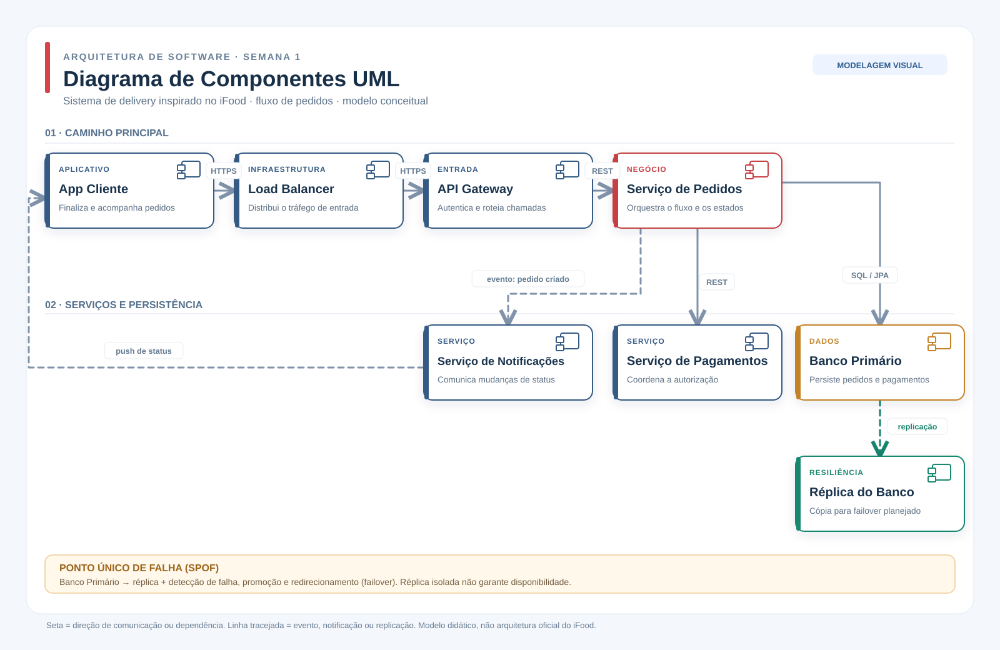

# Diagrama de Componentes UML — Plataforma de Delivery

> **Sistema escolhido:** plataforma de pedidos de comida inspirada no **iFood**.  
> **Natureza:** modelo didático e conceitual. O diagrama **não** representa nem afirma conhecer a arquitetura interna real do iFood.  
> **Tipo de entrega:** 100% modelagem visual, sem implementação de código.

## Parte 1 — Definição do escopo e dos componentes

**Escopo:** representar a jornada de um cliente desde o envio de um pedido até sua confirmação, incluindo processamento do pedido, pagamento, notificação e persistência dos dados. Não são detalhados catálogo, geolocalização, logística de entregadores, promoções ou telas internas.

| Componente | Responsabilidade |
|---|---|
| **App Cliente** | Permitir que o usuário finalize um pedido e receba seu status. |
| **Load Balancer** | Distribuir as requisições entre instâncias de entrada da API e ajudar a suportar mais acessos. |
| **API Gateway** | Centralizar o acesso, autenticar e encaminhar chamadas REST ao serviço responsável. |
| **Serviço de Pedidos** | Criar o pedido, gerenciar seus estados e coordenar pagamentos e notificações. |
| **Serviço de Pagamentos** | Coordenar a autorização do pagamento e fornecer seu resultado ao Serviço de Pedidos. |
| **Serviço de Notificações** | Processar eventos e enviar atualizações do pedido ao aplicativo do cliente. |
| **Banco Primário** | Armazenar os pedidos, seus estados e os registros de pagamentos. |
| **Réplica do Banco** | Manter cópia dos dados para recuperação e possível promoção em caso de falha do primário. |

## Parte 2 — Diagrama de componentes UML

O diagrama apresenta **oito componentes** com representação UML e conexões direcionadas. A ponta de cada seta aponta para o componente destinatário da chamada, evento ou replicação.

- **App Cliente → Load Balancer → API Gateway:** requisição HTTPS.
- **API Gateway → Serviço de Pedidos:** chamada REST.
- **Serviço de Pedidos → Serviço de Pagamentos:** solicitação REST para tratar o pagamento; o resultado retorna como resposta à chamada.
- **Serviço de Pedidos → Banco Primário:** persistência dos dados (SQL/JPA, como representação conceitual).
- **Serviço de Pedidos → Serviço de Notificações:** publicação de evento de pedido, representada por linha tracejada.
- **Serviço de Notificações → App Cliente:** comunicação de confirmação ou mudança de status por notificação push, de forma conceitual.
- **Banco Primário → Réplica do Banco:** replicação dos dados, representada por linha tracejada.

As setas representam **dependências e comunicação de alto nível**, não a ordem temporal exata de todas as operações, nem contratos de API reais.

## Parte 3 — Infraestrutura, fluxo narrado e ponto único de falha

### Componente adicional de infraestrutura

O **Load Balancer** é utilizado na entrada da arquitetura para distribuir acessos entre instâncias da API, reduzindo a sobrecarga em uma única instância. Na implantação real, essas instâncias precisam existir e ter sua saúde monitorada.

### Fluxo narrado de uma ação do usuário

Quando o usuário toca em **“Fazer pedido”** no App Cliente, o aplicativo envia uma requisição HTTPS ao Load Balancer, que a encaminha ao API Gateway. O Gateway valida a entrada e direciona a chamada ao Serviço de Pedidos. Esse serviço organiza os dados do pedido, solicita ao Serviço de Pagamentos o processamento do pagamento e persiste as informações no Banco Primário. Em seguida, um evento de atualização é enviado ao Serviço de Notificações, que comunica ao cliente a confirmação ou o estado do pedido. Em paralelo, os dados do banco primário são replicados para o banco secundário. Este é um **fluxo simplificado**, adequado à atividade de modelagem.

### Bônus: Single Point of Failure (SPOF)

O **Banco Primário** é identificado como potencial ponto único de falha: sem ele, a criação ou atualização dos pedidos pode ficar indisponível. A solução visual apresentada é a **Réplica do Banco**, conectada ao primário por uma seta de replicação. Em caso de falha, a réplica pode ser **promovida** para assumir as gravações, mediante um procedimento de **failover**. **A replicação isolada não garante alta disponibilidade:** uma solução de produção exigiria detecção de falhas, promoção, redirecionamento das conexões e testes de recuperação.

## Parte 4 — Reflexão

**Qual a importância de desenhar a arquitetura de um sistema antes de começar a codificar? Como o diagrama de componentes ajuda na comunicação entre a equipe técnica e os stakeholders?**

Projetar a arquitetura antes da implementação é como desenhar a planta de uma casa antes de construí-la: permite dividir responsabilidades, visualizar dependências, estimar necessidades de infraestrutura e identificar riscos antes que eles se tornem retrabalho. O diagrama de componentes ajuda os desenvolvedores a entender como cada parte se relaciona e serve como uma linguagem visual comum nas conversas com gerentes, investidores e demais stakeholders. Assim, as pessoas conseguem discutir o escopo, os custos, os pontos críticos e as decisões técnicas sem precisar analisar código-fonte.

## Arquivos da entrega

- [Visualizar o diagrama UML em SVG](assets/diagrama-componentes-ifood.svg) — imagem vetorial pronta para visualização no GitHub.
- [Editar o diagrama no draw.io](assets/diagrama-componentes-ifood.drawio) — arquivo editável usando os componentes e as setas UML.

## Publicação

Esta atividade está armazenada na pasta `semana 1` da branch `main` do repositório [joaopedro-25/arquitetura-de-software](https://github.com/joaopedro-25/arquitetura-de-software). O desenho é um **modelo didático**, não uma descrição da arquitetura interna real do iFood.
