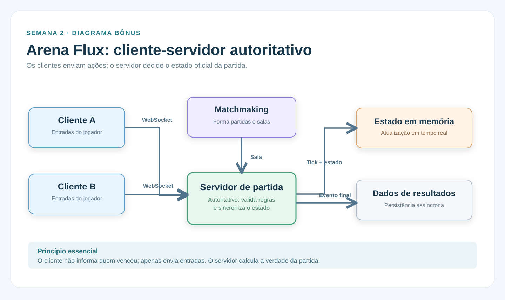

# Semana 2 — Escolha de Estilos Arquiteturais

**Disciplina:** Arquitetura de Software  
**Atividade:** estudo de caso teórico, sem código  
**Sistemas fictícios:** Vitrine 360 (e-commerce), Banco Horizonte (app bancário) e Arena Flux (jogo multiplayer).

> **Objetivo:** escolher e defender arquiteturas diferentes, com base nos requisitos não funcionais, nos objetivos de negócio e nos trade-offs.

## 1. Análise dos sistemas e decisão

| Sistema fictício | Contexto | Requisitos não funcionais críticos | Estilo escolhido |
|---|---|---|---|
| **Vitrine 360 — E-commerce** | Loja on-line com promoções sazonais e picos de acesso na Black Friday. | Escalabilidade elástica, resiliência, disponibilidade e evolução independente de funcionalidades. | **Microsserviços**, com integração orientada a eventos em processos assíncronos. |
| **Banco Horizonte — App bancário** | Aplicativo para saldo, extrato, transferências e pagamentos, operado por uma equipe de porte moderado. | Segurança, consistência forte, integridade transacional ACID, rastreabilidade e auditoria. | **Monolito modular**, com módulos de domínio bem separados e banco transacional. |
| **Arena Flux — Jogo multiplayer** | Jogo competitivo casual em partidas curtas com diversos usuários simultâneos. | Latência baixa, atualização de estado em tempo real, autoridade sobre regras e sincronização entre jogadores. | **Cliente-servidor autoritativo**, com canal persistente e servidor de partidas. |

### E-commerce: microsserviços

**Justificativa técnica:** catálogo, carrinho, pedidos, estoque e pagamentos têm padrões de carga e evolução diferentes. Separá-los permite escalar o catálogo durante campanhas sem replicar todo o sistema. Eventos desacoplam tarefas como confirmação, notificações e atualização de indicadores. Cada serviço protege suas próprias invariantes; **pagamentos e confirmação de estoque não podem depender cegamente de consistência eventual**.

**Justificativa de negócio:** equipes podem publicar mudanças de catálogo e promoções com menor acoplamento, mantendo a vitrine disponível em grandes picos. A opção se justifica para uma operação com volume e equipe capazes de sustentar automação, observabilidade e operação distribuída.

**Trade-off:** mais custo de rede, depuração distribuída, monitoramento, deploy e coordenação de transações. Em uma loja pequena, um monolito modular seria provavelmente mais econômico.

### App bancário: monolito modular

**Justificativa técnica:** transferências e alterações de saldo precisam de invariantes rígidas, persistência transacional e trilha de auditoria. Módulos isolados de autenticação, contas, transferências e auditoria mantêm fronteiras claras sem adicionar transações distribuídas entre serviços. A segurança depende de controles concretos, e **não do estilo por si só**: autenticação forte, autorização, criptografia, logs imutáveis e revisão.

**Justificativa de negócio:** para uma equipe moderada e produto inicial, uma implantação controlada e uma operação mais simples reduzem custo e aceleram conformidade e evolução.

**Trade-off:** implantação e escalabilidade mais acopladas; uma falha em processo compartilhado pode afetar vários módulos. Ao crescer, pode ser necessário extrair serviços específicos sem comprometer o núcleo contábil.

### Jogo multiplayer: cliente-servidor autoritativo

**Justificativa técnica:** clientes enviam entradas; o servidor valida regras e calcula o estado oficial da partida, transmitindo atualizações aos jogadores. Uma conexão persistente (por exemplo, WebSocket em jogo casual baseado em navegador) reduz overhead em relação a requisições HTTP repetidas. Para jogos competitivos de alta frequência, transportes como UDP/QUIC merecem avaliação específica.

**Justificativa de negócio:** o servidor autoritativo melhora justiça e previsibilidade de partidas, reduz exposição a fraudes triviais e facilita operar sessões e matchmaking.

**Trade-off:** custo de servidores, dependência da conectividade e necessidade de distribuir partidas por região. A distância física dos jogadores e o tick rate continuam impactando a latência. Peer-to-peer pode reduzir custo, mas aumenta riscos de manipulação e diferenças de conectividade.

## 2. Comparação e decisão

**Critério dominante:** e-commerce → escala e autonomia; banco → integridade e auditoria; jogo → latência e sincronização.

As arquiteturas não são mutuamente exclusivas: um e-commerce pode usar eventos dentro de microsserviços, um monolito modular ainda expõe APIs ao app e o jogo pode usar serviços separados para login e matchmaking. **O estilo escolhido descreve a organização predominante do núcleo do sistema**, não todas as tecnologias usadas.

## 3. Apresentação oral e bônus

- [Slides em PDF](slides/apresentacao-semana-2.pdf)
- [Roteiro da apresentação](slides/roteiro-apresentacao.md)
- [Documento completo do estudo de caso](docs/estudo-de-caso.md)
- [Diagrama bônus — Arena Flux (SVG)](diagramas/arena-flux-cliente-servidor.svg)

## 4. Reflexão: por que não existe uma arquitetura perfeita?

**Não existe “bala de prata”** porque sistemas enfrentam prioridades diferentes e exigências que frequentemente entram em conflito. Microsserviços facilitam escala e autonomia, mas elevam custos de observabilidade, rede e operação. Um monolito modular começa com menos complexidade, mas requer disciplina para evitar acoplamento e pode limitar deploys independentes. Cliente-servidor autoritativo traz controle e sincronização para jogos, mas exige infraestrutura de baixa latência.

**O contexto de negócio muda a escolha.** Com orçamento limitado, equipe pequena e prazo curto, a simplicidade pode valer mais que a escala teórica. Com alto volume, várias equipes e necessidade de evolução paralela, o investimento em distribuição pode compensar. A decisão deve acompanhar o estágio do produto e ser revista com medições reais de uso, incidentes e custos.

---

**Escopo didático:** todos os sistemas e diagramas são fictícios; as decisões são propostas argumentadas, não descrições de arquiteturas internas de empresas reais.
