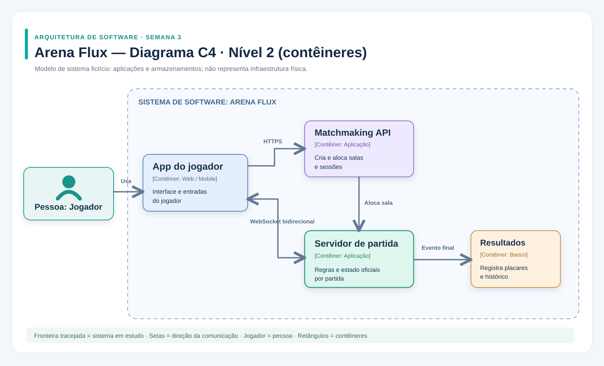

# Semana 3 — Defesa de Decisões Arquiteturais (ADR)

**Disciplina:** Arquitetura de Software  
**Entrega:** estudo de caso teórico + decisões arquiteturais + apresentação oral + C4, **sem código**.  
**Continuação:** [Semana 2 — estudo de caso inicial](../semana%202/README.md).  
**Casos fictícios mantidos:** **Vitrine 360** (e-commerce), **Banco Horizonte** (app bancário), **Arena Flux** (jogo multiplayer).

> **Mensagem para a diretoria:** não existe estilo universalmente melhor. Propomos soluções diferentes para proteger o resultado que mais importa em cada negócio e assumimos seus custos explicitamente.

## 1. RNFs priorizados e atributos ISO/IEC 25010:2023

**Critério da equipe:** **P0 = indispensável** (risco de inviabilizar a operação); **P1 = importante** (impacto significativo); **P2 = evolução desejável**. Prioridades são **hipóteses de projeto**, não medidas de produtos reais.

| Sistema | P0: crítica | P1: importante | P2: desejável | Atributo ISO/IEC 25010:2023 dominante |
|---|---|---|---|---|
| **Vitrine 360** | Escalabilidade elástica; checkout confiável | Disponibilidade; tempo de resposta | Independência de deploy; observabilidade | **Flexibilidade → Escalabilidade**. Associados: Confiabilidade → Disponibilidade; Eficiência de desempenho |
| **Banco Horizonte** | Segurança; integridade e consistência das transferências | Auditoria/rastreabilidade; recuperação | Independência de deploy | **Segurança**. Associados: Confiabilidade e adequação funcional |
| **Arena Flux** | Latência de atualização; sincronização autoritativa do estado | Disponibilidade de partidas; resistência a fraude | Evolução do matchmaking | **Eficiência de desempenho → Comportamento temporal**. Associados: Confiabilidade e Segurança |

**Nota de classificação:** na edição 2023, *escalabilidade* é subcaracterística de **flexibilidade**, *disponibilidade* integra **confiabilidade**, e o comportamento temporal integra **eficiência de desempenho**. **Consistência ACID** e **auditoria** são requisitos/restrições do domínio, relacionados a atributos como integridade e responsabilidade (*accountability*), e não nomes de características independentes da norma. [Referência: ISO/IEC 25010:2023](https://www.iso.org/standard/78176.html).

**Indicadores sugeridos para validação futura (exemplos, não garantias):**
- **Vitrine 360:** teste de carga 10×, taxa de erros no checkout e p95 do catálogo.
- **Banco Horizonte:** nenhuma transferência parcialmente confirmada, cobertura de trilha de auditoria e testes de controles de autorização.
- **Arena Flux:** latência p95 medida no servidor, divergências de estado por partida e tempo de reconexão.

Detalhes por sistema, risco e medidas: [docs/criterios-e-rnfs.md](docs/criterios-e-rnfs.md).

## 2. ADRs — registros de decisão arquitetural

### ADR-001 — Vitrine 360: microsserviços
- **Status:** **Aceito** (para o cenário fictício).
- **Contexto:** picos de acesso no e-commerce e necessidade de evoluir catálogo, pedidos e pagamentos com ritmos diferentes.
- **Decisão:** **microsserviços por domínio**, com integração por eventos apenas em fluxos adequados ao assíncrono. Pagamento e estoque exigem idempotência e garantias consistentes.
- **Consequências positivas:** escalonamento independente, autonomia de equipe, menor acoplamento de deploy.
- **Consequências negativas:** maior custo operacional, monitoramento distribuído, falhas de rede e coordenação de dados mais difícil.
- **Mitigação:** observabilidade, timeouts, controle de retries, circuit breakers, testes de contrato e revisão dos custos.
- **Documento formal:** [adr/adr-001-ecommerce.md](adr/adr-001-ecommerce.md).

### ADR-002 — Banco Horizonte: monolito modular
- **Status:** **Aceito** (para o cenário fictício).
- **Contexto:** banco digital em expansão com equipe moderada, transações financeiras críticas e exigência de auditoria.
- **Decisão:** **monolito modular** com fronteiras para contas, transferências, identidade e auditoria; banco transacional com validação de invariantes.
- **Consequências positivas:** gestão transacional mais direta, menor complexidade operacional e trilha de mudança concentrada.
- **Consequências negativas:** deploy conjunto, escalabilidade mais acoplada e risco de dependências internas excessivas.
- **Mitigação:** modularidade testável, controles de segurança, monitoramento e plano gradual de extração se necessário.
- **Documento formal:** [adr/adr-002-app-bancario.md](adr/adr-002-app-bancario.md).

### ADR-003 — Arena Flux: cliente-servidor autoritativo
- **Status:** **Aceito** (para o cenário fictício).
- **Contexto:** partidas curtas, vários jogadores simultâneos e necessidade de estado consistente e baixa latência.
- **Decisão:** **cliente-servidor autoritativo**: cliente envia entradas; servidor valida regras e publica o estado oficial. Para o jogo casual web, considerar conexão persistente por WebSocket.
- **Consequências positivas:** justiça da partida, sincronização e regras sob controle do servidor.
- **Consequências negativas:** custo por sessão, pontos de falha por partida e latência dependente de região/rede.
- **Mitigação:** distribuição regional de servidores, capacidade por sala e monitoramento de latência.
- **Documento formal:** [adr/adr-003-jogo-multiplayer.md](adr/adr-003-jogo-multiplayer.md).

> **Decisões condicionais:** o status Aceito registra a escolha **para as hipóteses desta atividade**. Não implica que essas arquiteturas sejam as melhores para qualquer empresa ou volume.

## 3. Defesa para stakeholders

| Caso | O que a diretoria ganha | O investimento/custo assumido | Condição para continuar |
|---|---|---|---|
| E-commerce | Melhor resposta a picos, releases por domínio | Plataforma, observabilidade e equipe de operação | Testes de carga + custo por pedido |
| Banco | Menor complexidade no núcleo financeiro inicial | Menor autonomia de deploy | Integridade, segurança, auditoria e testes de recuperação |
| Multiplayer | Partidas mais justas e sincronizadas | Servidores, operação regional e conexões persistentes | Latência real, custo por sala e disponibilidade |

**Regra de comunicação:** defender a decisão em **receita protegida, perda evitada, prazo de entrega e custo operacional**, sem prometer resultados que ainda dependem de teste. Documento para reunião: [docs/defesa-para-diretoria.md](docs/defesa-para-diretoria.md).

## 4. Cenário de crise: crescimento de 10× em um mês

| Sistema | A arquitetura consegue? | Gargalo provável | Ação sem comprometer a regra principal |
|---|---|---|---|
| Vitrine 360 | **Possivelmente, com infraestrutura e testes prévios** | Estoque, banco, pagamentos e filas | Escalar serviços de leitura, cachear catálogo, dimensionar filas, testar checkout end-to-end |
| Banco Horizonte | **Não automaticamente** | Escritas concorrentes e banco transacional | Otimizar queries, escalar leitura sem quebrar transações, reforçar capacidade/HA, limitar carga segura |
| Arena Flux | **Se houver capacidade de servidores e matchmaking** | Salas, CPU, regiões e conexões | Criar servidores por região, autoalocação de salas, admissão controlada, monitorar latência |

**Não afirmar:** “10× está garantido só por escolher o estilo”. O custo, a infraestrutura, os testes e os limites físicos permanecem.

## 5. Diagrama C4 e apresentação

**C4 — nível 2, contêineres**, do jogo fictício Arena Flux. Mostra usuários, aplicações e base de dados (não classes nem infraestrutura de baixo nível).

- [Diagrama C4 em SVG](diagramas/c4-arena-flux-containers.svg)
- [Apresentação à diretoria — PDF](slides/apresentacao-semana-3.pdf)
- [Roteiro para apresentação oral](slides/roteiro-apresentacao.md)

## 6. Reflexão — ADR versus diagrama

O **diagrama** mostra **quais partes existem e como se comunicam**. O **ADR** registra **por que a equipe escolheu aquela estrutura, quais alternativas avaliou e que dívida técnica aceitou**. Sem ADR, futuras equipes podem substituir a solução por acharem que ela é “complicada”, ignorando o motivo original; ou manter uma escolha antiga mesmo quando o contexto mudou. Os dois artefatos se complementam: o desenho explica a organização; o ADR preserva o raciocínio, as restrições e os critérios de revisão.

Para um stakeholder interessado em **dinheiro e prazos**, não se defende “microsserviços porque são modernos”. Explica-se: **“Nossa loja espera picos; separar catálogo do checkout evita ampliar tudo ao mesmo tempo, mas exige investir em observabilidade e testes. Vamos aprovar só se a carga simulada e o custo por pedido justificarem.”** No banco: **“Apostamos em um núcleo simples de operar para reduzir risco de lançamentos e retrabalho transacional.”** No jogo: **“Investimos em servidores autoritativos para preservar a experiência e reduzir disputas de resultado.”** Essas são **hipóteses de valor**, a validar com dados — não promessas financeiras.

## Referências

- [ISO/IEC 25010:2023 — modelo de qualidade de produto](https://www.iso.org/standard/78176.html)
- [C4 Model — introdução e níveis de diagramas](https://c4model.com/introduction)
- [Semana 2 — decisões preliminares](../semana%202/README.md)

**Natureza:** sistemas fictícios; documento educacional; sem código, deploy ou análise de produtos reais.
