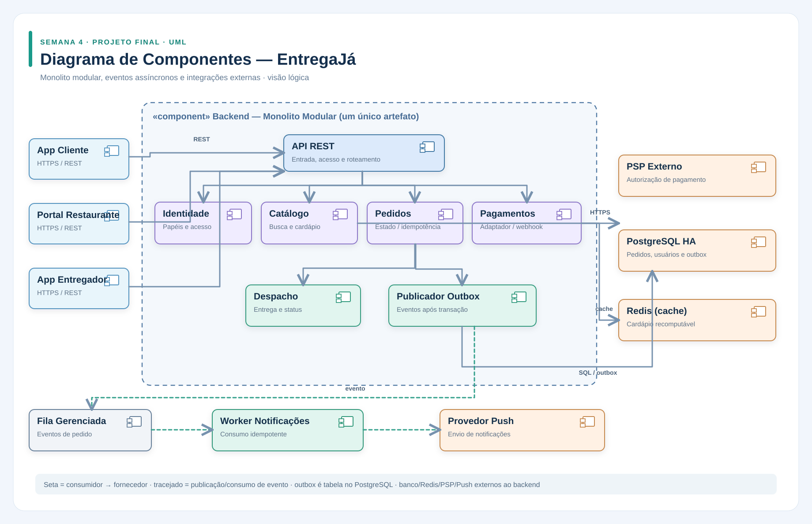
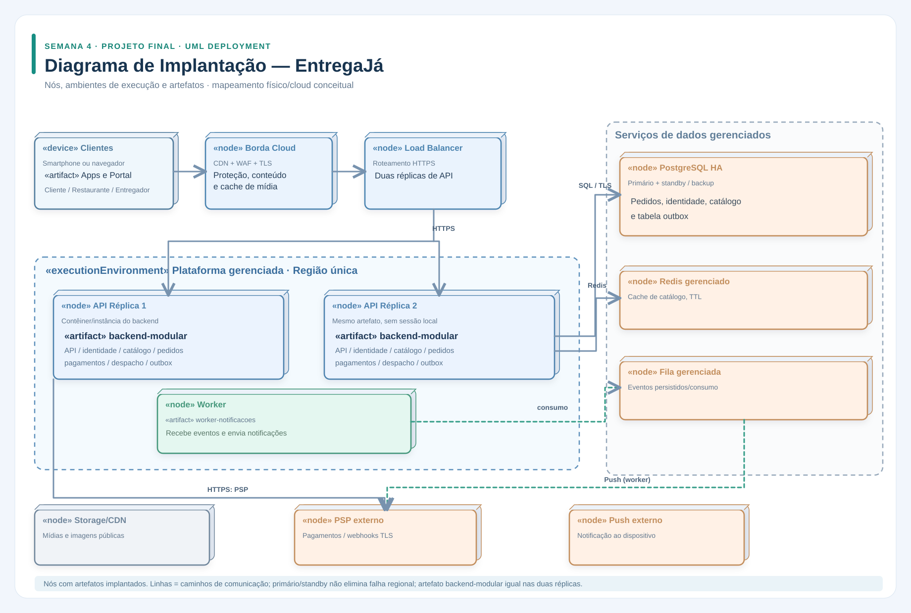

# Semana 4 — Projeto Final de Arquitetura de Software

**Projeto conceitual:** **EntregaJá**, plataforma fictícia de delivery urbano.  
**Entrega:** 100% modelagem e documentação, **sem código**.  
**Contexto:** projeto final, com diagramas UML, atributos de qualidade, apresentação e peer review.

> **Premissa importante:** a descrição textual específica atribuída pelo professor **não foi fornecida nesta conversa**. Para concluir uma proposta-modelo, a equipe adotou o cenário fictício abaixo. Se o professor atribuiu outro sistema ou requisitos, a documentação deverá ser revisada antes da entrega.

## 1. Cenário e escopo

A EntregaJá conecta **clientes, restaurantes e entregadores**. O cliente consulta cardápios, cria o pedido e paga por meio de um provedor externo; o restaurante aceita e prepara; o entregador recebe a corrida e informa status; o cliente acompanha a entrega e recebe notificações.

**Fora de escopo do MVP:** carteira própria, armazenamento de números completos de cartões, roteirização avançada, programa de pontos e múltiplos países.

**Restrições assumidas (hipotéticas):** equipe de cinco pessoas, até 12 semanas para um MVP, orçamento limitado, lançamento inicial em uma única região e serviços gerenciados para reduzir operação.

## 2. Lista de atributos de qualidade e RNFs

**P0** = essencial para lançar; **P1** = muito importante; **P2** = pode evoluir após o MVP. Critérios são **metas propostas**, ainda não medidas.

| Prioridade | Atributo ISO/IEC 25010:2023 | RNF e meta verificável proposta | Por quê |
|---|---|---|---|
| **P0 / 1º** | **Segurança** | TLS em todo tráfego externo; autorização por papel e por recurso; nenhuma informação completa de cartão armazenada; webhooks de pagamento autenticados | Protege contas, pedidos e fluxos financeiros |
| **P0 / 2º** | **Confiabilidade** (disponibilidade e recuperabilidade) | Meta de 99,9% de disponibilidade mensal da API de checkout; recuperação por failover testado; RPO-alvo até 5 min e RTO-alvo até 60 min | Pedidos não devem parar diante de uma falha simples |
| **P0 / 3º** | **Adequação funcional / correção** | Nenhum pedido confirmado sem estado coerente de pagamento; requisições repetidas não podem cobrar duas vezes | A correção do pedido evita perdas financeiras e reclamações |
| **P1 / 4º** | **Eficiência de desempenho** (comportamento temporal) | Busca de restaurantes e cardápios com p95 ≤ 300 ms no backend; criação de pedido com p95 ≤ 800 ms, sem incluir a espera no provedor externo | Evita abandono de compra |
| **P1 / 5º** | **Flexibilidade** (escalabilidade) | Testar aumento de 5× em consultas e 2× em checkout, mantendo metas acordadas | Suporta campanhas sem escalar tudo por antecipação |
| **P1 / 6º** | **Manutenibilidade** (modularidade) | Módulos com interfaces estáveis; alterações em catálogo não alteram invariantes de pagamento | Permite entrega por equipe reduzida |
| **P2 / 7º** | **Capacidade de interação** | Navegação clara, estados de erro compreensíveis e recursos básicos de acessibilidade | Facilita adoção e reduz chamados |

**Prioridade dominante:** **Segurança**, por envolver contas, endereços e pagamentos. A prioridade não dispensa disponibilidade ou consistência. A **ISO/IEC 25010:2023** define o modelo de qualidade; as metas numéricas são hipóteses da equipe, não números prescritos pela norma. [Fonte oficial](https://www.iso.org/standard/78176.html).

Detalhamento e aceitação: [docs/01-cenario-e-rnfs.md](docs/01-cenario-e-rnfs.md).

## 3. Arquitetura escolhida

**Estilo predominante:** **monolito modular** no backend (Identidade, Catálogo, Pedidos, Pagamentos, Despacho e Publicação de eventos), com **worker assíncrono separado** para notificações.

**Motivo:** no MVP com equipe e orçamento reduzidos, centralizar transações locais e simplificar deploy e debug oferece melhor custo-benefício do que dividir tudo em microsserviços. Um **outbox transacional** registra eventos no mesmo banco que altera o pedido, e um publicador os envia à fila. O worker consome a fila de modo idempotente. A solução preserva fronteiras para possível extração futura sem pagar desde já o custo operacional da distribuição integral.

**Benefícios:** menor complexidade inicial, rastreabilidade dos pedidos, escalonamento horizontal da API sem estado de sessão e filas para tarefas não críticas.

**Custos/trade-offs:** deploy conjunto dos módulos, banco relacional como recurso compartilhado, dependências externas e necessidade de observabilidade e controle de falhas mesmo sem microsserviços.

**Decisão registrada:** [docs/adr-001-arquitetura-entregaja.md](docs/adr-001-arquitetura-entregaja.md).

## 4. Diagramas UML

### 4.1 Diagrama de Componentes



- [Abrir imagem vetorial SVG](diagramas/diagrama-componentes.svg)
- [Editar no draw.io](diagramas/diagrama-componentes.drawio)

**Leitura:** aplicativos consomem a API REST; o monolito delega aos módulos; PostgreSQL persiste dados e o outbox; Redis acelera leituras; o publicador alimenta a fila; o worker envia notificações; pagamentos são processados pelo PSP externo.

### 4.2 Diagrama de Implantação



- [Abrir imagem vetorial SVG](diagramas/diagrama-implantacao.svg)
- [Editar no draw.io](diagramas/diagrama-implantacao.drawio)

**Leitura:** dispositivos do cliente acessam CDN/WAF e balanceador; duas réplicas do backend modular rodam em plataforma gerenciada; notificações usam worker; dados ficam em PostgreSQL gerenciado com réplica/standby, Redis, fila e storage. PSP e serviço de push são externos.

**Consistência entre diagramas:** [docs/03-mapeamento-componentes-implantacao.md](docs/03-mapeamento-componentes-implantacao.md).

## 5. Resumo da infraestrutura e proteção contra falhas

- **Entrada:** HTTPS, CDN/WAF, Load Balancer; API em 2 réplicas stateless.
- **Dados:** PostgreSQL gerenciado com primário + standby, backup e teste de failover; Redis apenas para dados recomputáveis.
- **Eventos:** outbox transacional no PostgreSQL, publicador na aplicação, fila gerenciada e worker de notificações.
- **Externo:** gateway de pagamentos (PSP), serviço de push; respostas e webhooks assinados e idempotentes.
- **Observabilidade:** logs estruturados, métricas, rastreamento das jornadas e alertas.

**SPOF e falhas residuais:** standby não evita todas as falhas de banco, uma região única pode cair inteira e PSP/push podem ficar indisponíveis. Replicação + backups **não garantem sozinhos** RPO/RTO; os valores devem ser medidos em testes. [Riscos e trade-offs](docs/04-riscos-e-tradeoffs.md).

## 6. Pitch, peer review e reflexão

- [Pitch para stakeholders — PDF](apresentacao/pitch-entregaja-semana-4.pdf) — apresentação de aproximadamente 10 a 15 minutos.
- [Roteiro oral](docs/05-roteiro-apresentacao.md).
- [Rubrica de peer review e formulário de parecer](docs/06-peer-review.md).

**O que ainda requer ação humana:** apresentar oralmente em sala e avaliar um projeto real de outro grupo. A rubrica está preparada, mas **nenhuma avaliação de colegas foi inventada**.

### Reflexão

O **Diagrama de Implantação** é essencial para infraestrutura e DevOps porque conecta os componentes lógicos ao ambiente real de execução: revela onde cada artefato roda, o caminho de rede, limites de capacidade, dependências externas, pontos de falha, dados persistentes e responsabilidades de operação. Um diagrama lógico pode parecer resiliente enquanto a implantação expõe um único servidor ou banco sem recuperação; por isso os dois desenhos devem ser coerentes.

O **peer review** é poderoso porque coloca a equipe diante de outras escolhas e restrições, obrigando-a a justificar evidências e trade-offs. A revisão por pares ajuda a identificar componentes ausentes, falhas de segurança, custos implícitos e incoerências entre requisitos e infraestrutura. O feedback precisa ser **específico, respeitoso e acionável**: citar o trecho do projeto, apontar o impacto e sugerir melhoria viável.

## 7. Organização do repositório

```text
semana 4/
├── README.md
├── docs/
│   ├── 01-cenario-e-rnfs.md
│   ├── 02-documento-de-arquitetura.md
│   ├── 03-mapeamento-componentes-implantacao.md
│   ├── 04-riscos-e-tradeoffs.md
│   ├── 05-roteiro-apresentacao.md
│   ├── 06-peer-review.md
│   └── adr-001-arquitetura-entregaja.md
├── diagramas/
│   ├── diagrama-componentes.svg
│   ├── diagrama-componentes.drawio
│   ├── diagrama-implantacao.svg
│   └── diagrama-implantacao.drawio
└── apresentacao/
    └── pitch-entregaja-semana-4.pdf
```

**Fontes:** [ISO/IEC 25010:2023](https://www.iso.org/standard/78176.html) · [UML — OMG](https://www.omg.org/spec/UML/) · [C4 Model](https://c4model.com/).

**Todos os sistemas, números e restrições de cenário são didáticos e hipotéticos.**
